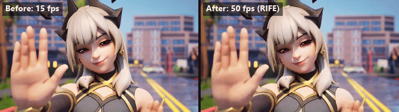
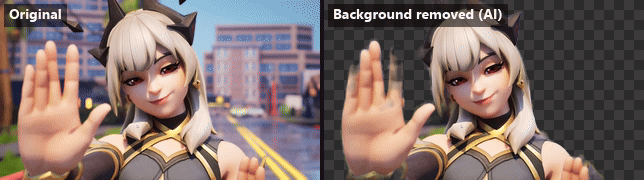
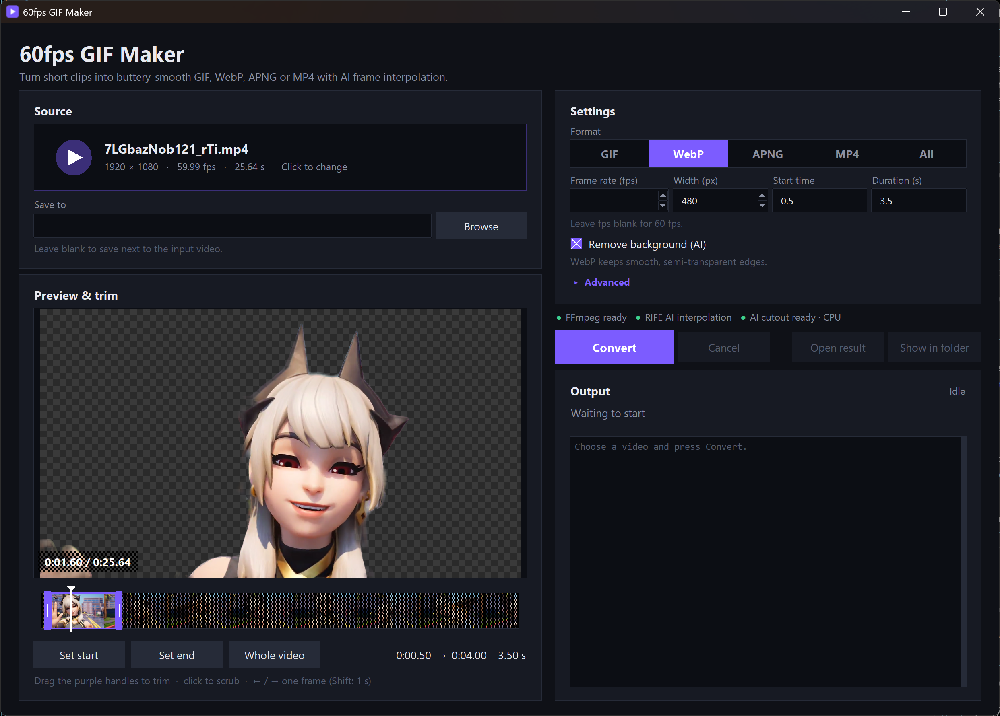

# 60fpsgif or try to anyways

Turn a short video into a buttery-smooth, high-frame-rate GIF (or WebP / APNG / MP4 / AVIF) using AI frame interpolation.

## Examples

**Before → after.** A 4 s clip (Fortnite in case your wondering) dropped to a choppy 15 fps, then rebuilt to 50 fps by RIFE (140 of the 200 frames are AI-generated):



Both halves are one GIF, so they always play in sync. The separate files are [before_15fps.gif](examples/before_15fps.gif) and [after_50fps.gif](examples/after_50fps.gif).

```
python fpsgif.py clip_15fps.mp4 -w 360 -o examples/after_50fps.gif
```

**Same clip, every format.** 4 s at 360 px:

| Format | FPS | Size | File |
|---|---|---|---|
| GIF | 50 | 7.7 MB | [demo.gif](examples/demo.gif) |
| WebP | 60 | 2.2 MB | [demo.webp](examples/demo.webp) |
| MP4 (silent, loops like a GIF) | 60 | **0.25 MB** | [demo.mp4](examples/demo.mp4) |

```
python fpsgif.py video.mp4 -s 0 -t 4 -w 360 -o examples/demo.gif   # or .webp / .mp4
```

## Background removal example

The same clip with the background cut out by AI (see [Remove the background](#remove-the-background)). The original is on the left and the cutout on the right; the checkerboard marks the transparent areas:



| File | Format | FPS | Size |
|---|---|---|---|
| [background_removed.gif](examples/background_removed.gif) | GIF, side by side (above) | 50 | 8.2 MB |
| [background_removed.webp](examples/background_removed.webp) | WebP, actually transparent | 50 | 2.0 MB |

```
python fpsgif.py video.mp4 -t 4 -w 320 --remove-bg -o cutout.webp
```

## Requirements

- Python 3.9+
- [FFmpeg](https://ffmpeg.org/) (`ffmpeg` and `ffprobe` on PATH)
- Optional but recommended: RIFE for AI interpolation — install with:

```
python setup_tools.py
```

This downloads [rife-ncnn-vulkan](https://github.com/nihui/rife-ncnn-vulkan) into `tools/`. It runs on any Vulkan-capable GPU (NVIDIA / AMD / Intel). Without it, the tool falls back to FFmpeg's `minterpolate` (CPU, more artifacts).

- Optional: AI background removal (see [below](#remove-the-background)):

```
pip install -r requirements.txt
python setup_tools.py --matting
```

## Desktop app



Prefer clicking to typing? Double-click **`fpsgif_gui.pyw`** (or run `python fpsgif_gui.pyw`). Pick a video, scrub through it in the **Preview & trim** panel and drag the handles to select the part you want, choose the format, fps and width, then hit **Convert**. Progress streams into the log, and **Open result** / **Show in folder** take you to the file. If RIFE isn't installed yet, the app shows an **Install RIFE** button. It uses only Python's built-in tkinter, so nothing extra needs installing.

### Build a standalone .exe

```
pip install pyinstaller
python build_exe.py
```

This creates `dist/60fps GIF Maker.exe`, a single file you can put anywhere (desktop, Start menu, another PC) and double-click, with no Python needed. FFmpeg still has to be on PATH. RIFE is looked for in a `tools/` folder next to the exe, so either copy `tools/` over or click **Install RIFE** in the app.

## Command line

```
python fpsgif.py clip.mp4                      # -> clip_50fps.gif
python fpsgif.py clip.mp4 -o smooth.webp       # true 60 fps WebP
python fpsgif.py clip.mp4 -o smooth.mp4        # tiny 60 fps "GIF video" (like Imgur's .gifv)
python fpsgif.py clip.mp4 -o smooth.avif      # small 60 fps AVIF (can be transparent or HDR)
python fpsgif.py clip.mp4 -f all               # GIF + WebP + APNG + MP4 + AVIF
python fpsgif.py clip.mp4 -s 3 -t 4 -w 360     # 4 s starting at 0:03, 360 px wide
```

| Option | Meaning |
|---|---|
| `-o, --output` | Output file; extension picks the format |
| `-f, --format` | `gif` (default), `webp`, `apng`, `mp4`, `avif`, or `all` |
| `--fps` | Target fps (default 50 for GIF, 60 for others) |
| `-w, --width` | Output width, `0` = original (default 480) |
| `-s, --start` / `-t, --duration` | Trim the clip |
| `--engine` | `auto`, `rife`, or `ffmpeg` |
| `--rife-model` | RIFE model folder (default `rife-v4.6`; try `rife-anime` for cartoons) |
| `--gpu` | GPU id for RIFE (`-1` = CPU) |
| `--remove-bg` | Cut out the background with AI (see below) |
| `--bg-color` | Background colour for MP4 with `--remove-bg` (default `black`) |
| `--hdr` | Keep an HDR source as HDR, written as a 10-bit HDR AVIF (see below) |

## Remove the background

`--remove-bg` (or **Remove background (AI)** in the app) cuts out the person or character and makes everything else transparent. The app previews the cutout on a checkerboard before you convert. See the [background removal example](#background-removal-example) for a demo.

It uses [RobustVideoMatting](https://github.com/PeterL1n/RobustVideoMatting), a 15 MB video matting model run through onnxruntime. Unlike single-image cutout models it carries information from frame to frame, so the edges stay steady instead of flickering. It runs on the CPU at about 15 ms per 480 px frame, so a 10 s clip adds roughly 10 s. To use a GPU, install `onnxruntime-directml` (any DirectX 12 GPU on Windows) or `onnxruntime-gpu` (NVIDIA CUDA) instead of `onnxruntime`.

| Format | Result |
|---|---|
| WebP / APNG / AVIF | Smooth, semi-transparent edges |
| GIF | Transparent, but GIF can only make a pixel fully on or off, so edges are harder |
| MP4 | H.264 can't be transparent, so the background becomes a solid colour (`--bg-color`) |

The cutout runs after interpolation, on every final frame, because RIFE ignores transparency. It works best on clearly visible people or characters. Fast motion blur, particles and glow effects can leave soft or flickering edges.

## HDR video

GIF, WebP, APNG and the H.264 MP4 are all 8-bit SDR, so HDR can't survive in them. AVIF can: it stores 10-bit colour with the HDR brightness range (PQ or HLG), and Chrome, Firefox and Safari play animated AVIF.

When the input is HDR (an iPhone HDR video, an HDR game capture), the app shows a **Keep HDR (outputs HDR AVIF)** toggle, and the CLI takes `--hdr`:

- **Off (default):** every format is tone-mapped to normal SDR colours. Without this an HDR clip comes out grey and washed out.
- **On:** the output is a 10-bit HDR AVIF. With `-f all`, only the AVIF is HDR and the rest are tone-mapped.

```
python fpsgif.py hdr_clip.mov --hdr -o smooth.avif
```

Things to know:

- HDR only looks like HDR on an HDR screen with HDR turned on (on Windows: Settings → Display → Use HDR). Elsewhere the viewer tone-maps it.
- RIFE and the AI cutout work on 8-bit images, so frames they touch carry the HDR signal in 8 bits, and smooth gradients like skies can band slightly. With no interpolation (source already at the target fps), the AVIF is 10-bit from end to end.
- Many sites re-encode uploads and may drop HDR. AVIF keeps it when the file is served as-is.

## Why GIFs are capped at 50 fps

GIF stores frame delays in 1/100 s units, so 60 fps (16.67 ms) can't be represented, and browsers slow any delay under 20 ms down to ~100 ms. **50 fps is the highest GIF rate that plays correctly everywhere.** For real 60 fps, use WebP (smaller, widely supported), AVIF (smaller still, all current browsers) or APNG (lossless, large).

## Why MP4 is so much smaller

Sites like Imgur don't actually serve GIFs — they convert them to silent, looping MP4 (`.gifv`). A video codec stores only what *changes* between frames, in full color, instead of a whole 256-color image per frame. The full 25 s source clip at 480 px came out at **85 MB as GIF, 20 MB as WebP, and 2.3 MB as MP4**. Use MP4 anywhere that plays video inline (Discord, X, Reddit, `<video autoplay loop muted playsinline>`); use GIF only where a real `.gif` is required.

## Tips

- Keep clips short (< 10 s) and narrow (≤ 480 px) — high-fps GIFs get big fast.
- Fast motion, scene cuts, and on-screen text are the hardest cases for interpolation.
